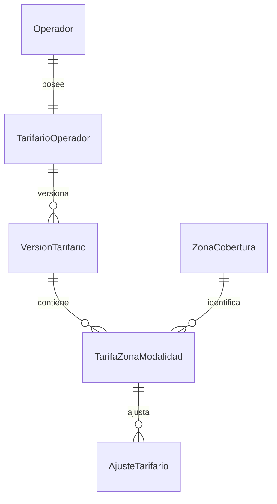

# CU-03 — Tarifas configurables

**Estado: Fase 2 backend implementada, CU-03 no está completo.** Este documento conserva el diseño y distingue lo ya incorporado de lo pendiente. CU-03 configura y publica el cuadro tarifario; CU-09 calculará y registrará el importe de un envío usando la versión vigente. La creación de envíos todavía no consume este módulo.

| Estado | Alcance |
|---|---|
| **Implementado** | Dominio de tarifario/versiones/tarifas/ajustes; calculador puro; casos de uso de consulta, borrador, edición, publicación y simulación; repositorio EF; migración PostgreSQL con RLS, claves compuestas, concurrencia e inmutabilidad. |
| **Comprobado** | Pruebas unitarias del cálculo y reglas de dominio; pruebas efímeras PostgreSQL/PostGIS de migraciones, decimales, referencias, RLS restringida, publicación/copia/inmutabilidad y carreras de edición/publicación. Ver detalle en [Fase 2: evidencia](#11-fase-2-backend-evidencia). |
| **Pendiente** | Controladores HTTP, ApiClient, OpenAPI, Backoffice y recorrido local. CU-09 aún debe integrar el calculador y guardar el snapshot de precio/revisión de zona dentro del alta. No se aplicó la migración al PostgreSQL persistente. |

El calculador recibe configuración tarifaria y bultos ya preparados: no accede a repositorios, no autoriza al actor y no resuelve la versión vigente. El simulador obtiene y autoriza esa configuración antes de invocarlo; CU-09 deberá hacer lo mismo dentro de su flujo de alta.

## 1. Alcance y trazabilidad

### Requisitos que sí aparecen en las fuentes

| Fuente | Texto/registro | Alcance que se desprende |
|---|---|---|
| [Laboratorio, §3.1–3.3, PDF pp. 3–4](../../../docs/alcance/Laboratorio__NET_2026.pdf) | Cada operador tiene sus zonas y cuadro tarifario, y no accede a los datos de otros operadores. | Un tarifario pertenece a un operador y queda aislado por tenant. |
| [Laboratorio, §4, PDF p. 4](../../../docs/alcance/Laboratorio__NET_2026.pdf) | Backoffice ASP.NET Core Razor Pages incluye configuración del cuadro tarifario. | La gestión se integra en el Backoffice existente. |
| [Laboratorio, §5.1.3, PDF p. 4](../../../docs/alcance/Laboratorio__NET_2026.pdf) | La tarifa varía al menos por zona, peso, volumen y modalidad estándar/urgente; admite recargos y bonificaciones; se configura desde la interfaz sin modificar código ni desplegar. | Deben poder configurarse esos componentes en ejecución. No prescribe una fórmula ni el algoritmo de ajustes. |
| [Laboratorio, §5.2.8–5.2.9, PDF p. 5](../../../docs/alcance/Laboratorio__NET_2026.pdf) | Un envío puede contener uno o más bultos con peso y dimensiones; la tarifa se calcula automáticamente al alta según el cuadro vigente del operador. | CU-09 debe calcular con los bultos del envío y resolver la versión vigente al registrar. |
| [Laboratorio, §6.5–6.6, PDF p. 7](../../../docs/alcance/Laboratorio__NET_2026.pdf) | Se requiere aislamiento multitenant; tarifas editables desde la interfaz, en ejecución y versionadas, conservando el tratamiento de envíos anteriores. | Aislamiento efectivo y versiones publicadas que no cambian retroactivamente los importes ya aplicados. |
| [XLSM, `CU obligatorios!A6:I6`](../../../docs/alcance/Calcs/Casos%20de%20Uso%20-%20Responsables.xlsm) | CU-03, “Tarifas configurables”: configurar por zona, peso, volumen y modalidad, con recargos y bonificaciones, desde la interfaz. M01; Backoffice; actor “Operador / administrador”; obligatorio. | Confirma el alcance anterior. La fila no asigna una persona responsable. |
| [XLSM, `Módulos!A4:F4`](../../../docs/alcance/Calcs/Casos%20de%20Uso%20-%20Responsables.xlsm) | M01 Administración y configuración; incluye tarifas y enumera Backoffice Razor Pages y API. Responsable del módulo: José Garcia. | La responsabilidad de José Garcia figura para M01, no como asignación individual de CU-03. |
| [XLSM, `CU obligatorios!A12:I12`](../../../docs/alcance/Calcs/Casos%20de%20Uso%20-%20Responsables.xlsm) | CU-09, “Cálculo de tarifa”: calcular automáticamente al alta según el cuadro vigente; M02; Portal/API; actor Comercio. | CU-09 consume la configuración de CU-03; no convierte la edición de tarifas en una función de Commerce. |
| [XLSM, `Dependencias!A5:I5`, D02](../../../docs/alcance/Calcs/Casos%20de%20Uso%20-%20Responsables.xlsm) | CU-09 depende de CU-03; el precio usa la versión vigente al alta; se registra un servicio de cálculo y un ID de versión; el riesgo señalado es el cambio retroactivo de precio. | La publicación y el identificador de versión deben llegar al cálculo del envío. |
| [XLSM, `No funcionales!A9:F9`, NFR-06](../../../docs/alcance/Calcs/Casos%20de%20Uso%20-%20Responsables.xlsm) | Tarifas y reglas editables en caliente y versionadas; los envíos previos conservan su tratamiento. | Reitera §6.6 como criterio no funcional. |

La planilla se inspeccionó como contenido XLSM; no se ejecutaron macros. Sus hojas son `Módulos`, `CU obligatorios`, `Alcance aplicaciones`, `Dependencias`, `No funcionales` y `Opcionales`; no hay una hoja que asigne una persona directamente a CU-03.

### Decisiones propuestas por el equipo

La fórmula, UYU, precisiones numéricas, política de publicación, estructura de datos y algoritmo de recargos/bonificaciones son decisiones del equipo implementadas en esta Fase 2; no aparecen como reglas prescritas por el laboratorio ni por la fila CU-03 del XLSM. No se añade tramos, peso volumétrico, impuestos, promociones, cupones ni tarifas por comercio.

### Diferencias y límites de las fuentes

- La descripción de CU-03 y el laboratorio exigen variación por zona, peso, volumen y modalidad, pero no dan una ecuación, moneda, precisiones, orden de ajustes ni redondeo. La fórmula de este diseño es decisión del equipo.
- La planilla registra D02 como dependencia **CU-09 → CU-03** (`Dependencias!A5:I5`) y no registra allí una dependencia explícita **CU-03 → CU-02**, aunque CU-03 debe referenciar zonas ya administradas por CU-02. El modelo propuesto consume esas zonas sin duplicarlas.
- D01 dice que un alta identifica comercio y operador y que un comercio puede trabajar con varios operadores; su columna de contrato nombra “vínculo comercio-operador” (`Dependencias!A4:I4`). Esto difiere de la decisión vigente: el operador se elige en cada envío y no hay membresía permanente. Para esta propuesta, D01 se interpreta como contexto/vínculo del envío, no como una relación persistente; conviene conservar esa precisión al implementar CU-07/CU-09.
- §6.6 y NFR-06 requieren versionado y conservación del tratamiento histórico, pero no prescriben que la administración use publicaciones explícitas ni definen su modelo. Esas son decisiones de diseño aquí.

## 2. Qué se reutiliza y qué falta

| Área | Reutilizar | Falta para CU-03/CU-09 |
|---|---|---|
| Zonas | [ZonaCobertura](../../src/NexoRuta.Domain/ZonasCobertura/ZonaCobertura.cs), [ZonaCoberturaRevision](../../src/NexoRuta.Domain/ZonasCobertura/ZonaCoberturaRevision.cs), [casos de uso](../../src/NexoRuta.Application/ZonasCobertura/UseCases/GestionarZonasCoberturaUseCase.cs) y [repositorio EF](../../src/NexoRuta.Infrastructure/ZonasCobertura/EfZonasCoberturaRepository.cs). Una zona tiene `OperadorId`, `Id`, estado, `RevisionActual` y `Version`; las revisiones guardan snapshots inmutables. | Referenciar la zona por su identidad compuesta operador/zona. No copiar geometría ni crear otra relación de cobertura. |
| Concurrencia | [NexoRutaDbContext](../../src/NexoRuta.Infrastructure/Persistence/NexoRutaDbContext.cs) marca versiones como tokens; la zona verifica su `Version` en dominio y el [controller de CU-02](../../src/NexoRuta.Api/Features/ZonasCobertura/Controllers/ZonasCoberturaController.cs) traduce conflictos a 409. | Reutilizado. El borrador tiene su propio token; edición, copia y publicación toman el mismo bloqueo del tarifario raíz antes de validar/escribir. |
| Identidad y permiso | [IUsuarioActual](../../src/NexoRuta.Application/Administracion/Interfaces/IUsuarioActual.cs), [ContextoUsuario](../../src/NexoRuta.Application/Administracion/Context/ContextoUsuario.cs), [CatalogoPermisos](../../src/NexoRuta.Domain/Administracion/CatalogoPermisos.cs) y [autorización dinámica](../../src/NexoRuta.Api/Core/Security/PermisoAuthorizationHandler.cs). | Reutilizado mediante `RequerirOperadorCoberturaUseCase`: exige acceso persistido activo de tipo Operador y `configuracion.gestionar`; el permiso por sí solo no basta porque el catálogo también lo asigna a Commerce. |
| RLS | [RlsTransactionMiddleware](../../src/NexoRuta.Api/Core/Security/RlsTransactionMiddleware.cs), [RlsTransaction](../../src/NexoRuta.Infrastructure/Persistence/RlsTransaction.cs), [migración RLS de zonas](../../src/NexoRuta.Infrastructure/Persistence/Migrations/20261019010048_AddCoverageZonesAndDeliverySlots.cs), [migración tarifaria](../../src/NexoRuta.Infrastructure/Persistence/Migrations/20261019152350_AddTarifarioOperador.cs) y [guía RLS](../../../docs/rls/README.md). La solicitud usa el `NexoRutaDbContext` y la transacción RLS existentes. | Implementado para las cuatro tablas tarifarias: operador del contexto, `ENABLE`/`FORCE ROW LEVEL SECURITY`, claves compuestas, propietario separado, privilegios mínimos y triggers persistentes de inmutabilidad. |
| Envío y bultos | [Bulto](../../src/NexoRuta.Domain/Envios/Bulto.cs) ya usa `decimal` para gramos y centímetros; [Envio](../../src/NexoRuta.Domain/Envios/Envio.cs) conserva el `OperadorId` seleccionado por envío. [CrearEnvioUseCase](../../src/NexoRuta.Application/Envios/UseCases/CrearEnvioUseCase.cs) obtiene el Comercio del contexto y valida/carga el operador elegido en esa solicitud. | `Envio` todavía no guarda modalidad, versión tarifaria ni importe. El comando/request actual ([CrearEnvioCommand](../../src/NexoRuta.Application/Envios/Commands/CrearEnvioCommand.cs), [CrearEnvioRequest](../../src/NexoRuta.Api/Features/Envios/Contracts/Requests/CrearEnvioRequest.cs)) admite un bulto por alta; CU-09 tendrá que calcular con todos los bultos del envío cuando incorpore el caso de uno o más bultos. |
| Backoffice y cliente | El [ApiClient tipado de CU-02](../../../frontend/src/NexoRuta.ApiClient/Features/ZonasCobertura/Clients/ZonasCoberturaApiClient.cs), sus [contratos](../../../frontend/src/NexoRuta.ApiClient/Features/ZonasCobertura/Contracts/ZonaCoberturaContracts.cs), PageModels Razor y [política de Backoffice](../../../frontend/src/NexoRuta.Backoffice/Program.cs) ofrecen el patrón por feature. | API, cliente tipado y páginas Razor tarifarias siguen pendientes. No se necesita otra aplicación ni otro cliente HTTP. |

## 3. Reglas de cálculo adoptadas por el equipo

### Tarifa base

Para la modalidad y zona seleccionadas:

```text
pesoTotalKg   = suma(bulto.PesoGramos) / 1.000
volumenTotalM3 = suma(bulto.LargoCm × bulto.AnchoCm × bulto.AltoCm) / 1.000.000

subtotal = importeBase
         + pesoTotalKg × precioPorKg
         + volumenTotalM3 × precioPorM3

totalSinPiso = subtotal + suma(recargos) − suma(bonificaciones)
totalUYU = redondear(max(0, totalSinPiso), 2, MidpointRounding.AwayFromZero)
```

- Los cálculos usan `decimal`. El importe base se aplica una vez al envío, no por bulto.
- El peso se convierte desde gramos a kilogramos. El volumen se calcula para cada bulto y luego se suma; no se multiplican dimensiones sumadas ni se usa peso volumétrico.
- Coeficientes propuestos: importe base y ajustes fijos `numeric(14,2)` UYU; precios por kg y por m³ `numeric(14,6)` UYU; porcentajes `numeric(5,2)` entre `0.00` y `100.00`. La moneda de cada versión es explícitamente `UYU`; no hay conversión cambiaria.
- Se conservan los decimales de los productos y ajustes durante el cálculo. Solo se redondea el total final a dos decimales y con `AwayFromZero`; las líneas del desglose retienen su importe decimal sin redondeo intermedio. Un valor fuera de las precisiones admitidas o una operación decimal desbordada se rechaza, no se satura ni se persiste un total parcial.
- Una tarifa existente con todos sus componentes en cero es una tarifa configurada de importe cero. La ausencia de la fila zona/modalidad significa que esa modalidad no se ofrece: CU-09 no la sustituye por otra, no asume cero y no registra el envío como cotizado.
- Bultos faltantes, medidas/pesos no positivos, modalidad desconocida, valores negativos de tarifa o ajustes inválidos son errores de validación. Si los descuentos superan subtotal más recargos, el importe facturable queda en cero; el desglose conserva el total antes del piso e indica que se aplicó el mínimo cero.

### Ejemplo verificable

Dos bultos: `1.500 g`, `40×30×20 cm` y `2.000 g`, `50×20×10 cm`. El total es `3,5 kg` y `0,034 m³` (`24.000 + 10.000 cm³`). Con base `UYU 120`, `UYU 25,50/kg` y `UYU 900/m³`:

```text
subtotal = 120 + 3,5×25,50 + 0,034×900 = UYU 239,85
recargos = UYU 12 fijo + 15%×239,85 = UYU 47,9775
bonificaciones = UYU 10 fijo + 5%×239,85 = UYU 21,9925
total exacto = 239,85 + 47,9775 − 21,9925 = UYU 265,835
total final = UYU 265,84
```

Los dos porcentajes usan siempre el subtotal original; no se capitalizan ni dependen del orden de los ajustes.

## 4. Ajustes cerrados

Cada ajuste pertenece a una tarifa `(zona, modalidad)` y se aplica siempre que esa tarifa sea la seleccionada para un envío. Sus tipos son cerrados:

| Tipo | Valor | Cálculo |
|---|---|---|
| Recargo fijo | Importe UYU no negativo | Se suma una vez al envío. |
| Recargo porcentual | Porcentaje `0–100` | Porcentaje del subtotal original. |
| Bonificación fija | Importe UYU no negativo | Se resta una vez al envío. |
| Bonificación porcentual | Porcentaje `0–100` | Porcentaje del subtotal original. |

Coinciden y se suman todos los ajustes configurados para la fila elegida. Se devuelven nombre, tipo, base de cálculo y monto decimal de cada uno. No hay condiciones por comercio, fecha, día, bulto ni fórmula configurable; el alcance es la zona y modalidad de esa fila. Los IDs brindan un orden estable de presentación, pero no cambian el resultado aditivo.

## 5. Modelo y estados implementados



| Tabla | Campos esenciales y responsabilidad |
|---|---|
| `TarifariosOperador` | `OperadorId uuid PK/FK`; `VersionVigenteId uuid NULL`; `UltimoNumeroPublicacion int`; `ActualizadoUtc`. Una fila por operador, un único puntero a la versión publicada vigente y contador persistente para asignar números bajo bloqueo. También es el punto de serialización compartido por edición/copia/publicación. |
| `VersionesTarifario` | PK `(OperadorId, Id)`; `Estado` (`Borrador`/`Publicada`); `NumeroVersionPublicada int NULL`; `VersionConcurrencia bigint`; `Moneda = UYU`; creador/fecha y publicador/fecha. El número de publicación solo existe al publicar; el token de concurrencia se incrementa al editar el borrador. |
| `TarifasZonaModalidad` | Clave `(OperadorId, VersionId, ZonaId, Modalidad)`; importes `numeric(14,2)` y precios unitarios `numeric(14,6)`. Una fila significa que se configuró esa modalidad para esa zona, aun si los precios valen cero. |
| `AjustesTarifario` | `Id uuid`; FK compuesta a `TarifasZonaModalidad`; `Nombre`; tipo cerrado; importe fijo `numeric(14,2) NULL`; porcentaje `numeric(5,2) NULL`. Una restricción por tipo exige exactamente el campo aplicable y su rango. |

Las claves foráneas `(OperadorId, VersionId)` y `(OperadorId, ZonaId)` impiden asociar filas entre operadores. La tarifa conserva solo la identidad de la zona, no su geometría. Cambiar nombre o geometría no reescribe la tarifa ni las versiones publicadas; no se fija una revisión geográfica al publicar. CU-09 guardará la revisión usada cuando cree un envío. Desactivar una zona tampoco borra tarifas ni impide copiarlas a un borrador; no es una oferta operativa mientras siga inactiva. Una reactivación permite volver a ofrecer la tarifa vigente si existe una fila para la modalidad.

Estados implementados: sin publicación puede existir un borrador inicial vacío; al publicar, ese borrador pasa a ser una versión publicada; después se crea explícitamente otro borrador copiando todas las tarifas y ajustes de la publicación vigente, también los asociados a zonas inactivas. Hay como máximo un borrador por operador. Publicar requiere al menos una fila de tarifa válida cuya zona esté activa; otras filas de zonas inactivas se conservan. La publicación no activa zonas.

## 6. Concurrencia, publicación e historial

- **Versión de concurrencia (`VersionConcurrencia`, `long`):** inicia en cero para el borrador y se incrementa exactamente una vez por cada reemplazo atómico de configuración de tarifas/ajustes. Se valida contra el valor esperado. Una versión obsoleta produce `ConflictoTarifarioException` (`tariff.draft_conflict`), que el futuro API traducirá a 409; no quedan cambios parciales.
- **Número publicado (`NumeroVersionPublicada`, `int`):** secuencia por operador asignada solo en publicación. Identifica una configuración histórica completa y no sirve para detectar ediciones simultáneas. El contador `UltimoNumeroPublicacion` del tarifario raíz se incrementa bajo su bloqueo; no se usa `MAX + 1` sin sincronización.
- **Protocolo común de escritura:** crear/copia de borrador, editar y publicar toman `SELECT ... FOR UPDATE` sobre la misma fila `TarifariosOperador` dentro de la transacción RLS vigente. Después se vuelve a leer el borrador y se compara `VersionConcurrencia`. Si una edición gana la carrera, la publicación lee la versión incrementada y conflictos; si la publicación gana, la edición encuentra que ya no hay borrador editable. No puede editarse después de publicar ni publicarse una configuración parcialmente editada. Las actualizaciones EF usan también el token de concurrencia persistido.
- **Publicar:** bajo ese bloqueo común se valida el borrador completo, se bloquean con `FOR SHARE` las filas de las zonas activas candidatas (para que una desactivación concurrente no invalide la comprobación), se requiere al menos una tarifa válida de zona activa, se asigna el siguiente número y se actualizan versión y puntero vigente en la misma transacción. Índices únicos por operador/número publicado y por borrador, FK del puntero y triggers diferidos protegen la coherencia; conflictos de unicidad/concurrencia se traducen al conflicto de aplicación.
- **Inmutabilidad:** un trigger persistente rechaza toda actualización/borrado de versiones publicadas y los triggers de tarifas y ajustes consultan el estado padre; sólo se permite mutar hijos de borradores. Otro trigger permite únicamente la transición inicial borrador→publicada, valida el incremento único de la versión al editar y protege el puntero/contador vigente. Publicar una versión nueva nunca actualiza la anterior.
- **Copia:** crear un borrador copia importes, ajustes y referencias zona/modalidad de la publicación vigente, no geometrías ni revisiones. Las tarifas de zonas inactivas también se copian. El borrador inicial, cuando aún no hay publicaciones, empieza vacío.
- **Revisiones de zona:** no se congelan ni copian al tarifario. La publicación referencia las identidades de zonas existentes; CU-09 capturará `RevisionActual` realmente utilizada al registrar el envío.
- **Envios históricos:** el tarifario publicado no basta como único dato auditable. CU-09 debe guardar al crear el envío, dentro de la transacción del alta, el total final UYU y un snapshot del desglose, `VersionTarifarioId/NumeroVersionPublicada`, modalidad, zona y `RevisionActual` usada, peso/volumen calculados y componentes/ajustes aplicados. Así no se recalcula un envío antiguo con precios actuales ni con geometría/franjas actuales. Este snapshot pertenece a CU-09, no al borrador de CU-03.

## 7. Autorización y RLS

| Actor/operación | Resultado previsto |
|---|---|
| Operador activo con `configuracion.gestionar` | Puede consultar su tarifario, editar su borrador, simularlo, publicarlo y consultar sus publicaciones anteriores. |
| Usuario de Operador sin el permiso | 403; no lee ni modifica el tarifario. |
| Otro operador | RLS limita todas las consultas y mutaciones al operador persistido. Un ID ajeno no revela ni altera recursos. |
| Commerce, aun con `configuracion.gestionar` | No administra tarifas: el endpoint de CU-03 exige ámbito Operador. CU-09 puede leer solo el cuadro publicado necesario para un envío autorizado. |
| Plataforma, identidad sin organización o anónimo | No obtiene acceso administrativo; se aplican los resultados existentes de autenticación/autorización (401/403). |

El `OperadorId` de gestión sale de `IUsuarioActual` y del acceso persistido activo, nunca de un formulario. Las cuatro tablas llevan `OperadorId`, `ENABLE` y `FORCE ROW LEVEL SECURITY`; su dueño es distinto de API/workers, que no son `SUPERUSER` ni `BYPASSRLS`. API no recibe `SELECT` global. Además de RLS, FKs compuestas vinculan tarifario, versión, tarifa y zona al mismo operador. Permisos de escritura cubren borradores y metadatos necesarios, no la modificación de datos ya publicados.

Para CU-09, la lectura cruzada necesaria no se resuelve dando a Commerce lectura general del catálogo tarifario. El caso de uso de alta valida el operador elegido para ese envío y reutiliza el contexto acotado de envío que ya ofrece `RlsTransaction` (`SelectedOperatorId`/`ShipmentId`); una política o función estricta expone únicamente la versión publicada vigente y la fila solicitada en ese contexto. No expone borradores ni versiones ajenas por consultas libres. Esto amplía de forma acotada la política de CU-09, no crea otro mecanismo de tenant.

## 8. Recorrido previsto en Backoffice (pendiente de interfaz)

1. El operador abre una sección **Tarifas** en el Backoffice autenticado y autorizado.
2. Consulta la publicación vigente (número, fecha y resumen) y, por separado, el estado y token de concurrencia del borrador. Una publicación anterior se presenta en modo solo lectura.
3. Crea el borrador copiando la publicación vigente (o uno vacío si es la primera vez). Selecciona una zona ya existente propia y configura fila Estándar y/o Urgente con base, precio/kg, precio/m³ y ajustes tipados. No crea zonas desde CU-03.
4. Simula con uno o más bultos. El resultado muestra entradas, conversión a kg/m³, importe base, cargos por peso/volumen, cada ajuste, subtotal, suma de recargos/bonificaciones, total previo al piso, redondeo y total UYU. La simulación de borrador no crea un envío ni publica.
5. Publica explícitamente tras revisar el cuadro. Un conflicto 409 informa que el borrador cambió y requiere recargar; no se reintenta silenciosamente. El borrador publicado queda inmutable y una nueva edición exige crear otra copia.

La simulación y CU-09 consumirán el mismo calculador determinista puro de Domain. El caso de uso de simulación ya obtiene el operador desde el contexto persistido, selecciona el tarifario propio y consulta el estado activo de la zona antes de llamar al cálculo; no publica ni escribe un precio de envío. La interfaz Backoffice aún no está implementada.

## 9. Contrato de cálculo para CU-09

Interfaz pura del calculador compartida por el simulador y el alta futura:

```text
CalculadoraTarifas.Calcular(tarifaExplicita, bultosPreparados)
  -> zona, modalidad, versión usada, moneda, medidas agregadas,
     importeBase, cargos por peso/volumen, ajustes detallados,
     subtotal, recargos, bonificaciones, totalExacto, totalFinal
```

El calculador no accede a repositorios, no resuelve permisos ni busca la publicación vigente. En CU-09, el servidor obtendrá por separado la publicación vigente y la tarifa para la zona/modalidad; el cliente no enviará precios, coeficientes ni un número de versión que pueda escoger para abaratar el envío. La consulta también obtendrá la revisión geográfica que se usa al crear el envío. En la respuesta de creación el monto y versión aplicados serán explícitos. Para una repetición idempotente de la misma alta, se conservará el snapshot ya persistido, no se volverá a cotizar con otra versión.

**Dependencia real pendiente entre CU-07/CU-09 y CU-02:** la dirección vigente de [Envio/Direccion](../../src/NexoRuta.Domain/Envios/Envio.cs) es texto; no contiene coordenadas. CU-02 consulta cobertura por coordenadas y devuelve todas las zonas coincidentes, sin elegir una. CU-09 necesita recibir una `ZonaId` resuelta para seleccionar la fila tarifaria. Antes de integrar el alta se debe definir cómo se obtiene/selecciona esa zona (y qué ocurre con zonas superpuestas); CU-03 no geocodifica ni elige una arbitrariamente. El operador sí se elige por envío en el `CrearEnvioUseCase` actual; no se agrega una relación comercio–operador.

## 10. Criterios de aceptación y pruebas

### CU-03

- Dos operadores pueden tener tarifas, borradores y publicaciones diferentes sin lecturas cruzadas.
- Una fila zona/modalidad con valores cero se distingue de una fila ausente.
- Un operador autorizado puede crear, editar y simular un borrador; publicar lo vuelve inmutable y deja un único vigente.
- Crear un nuevo borrador copia exactamente la versión vigente; publicar después crea una versión nueva sin cambiar las previas.
- Dos ediciones o publicaciones concurrentes no pisan cambios: la versión obsoleta produce 409 y rollback completo.
- FKs rechazan una zona de otro operador, y RLS rechaza acceso propio/ajeno/sin contexto conforme a la matriz.
- Commerce y Plataforma no pueden administrar por tener autenticación o un permiso de nombre coincidente.

### Calculador compartido / CU-09

- Pruebas deterministas para gramos→kg, volumen individual→m³ con múltiples bultos, base una vez, cuatro tipos de ajuste y porcentaje sobre subtotal original.
- Pruebas de total exacto con redondeo final `AwayFromZero`, total negativo limitado a cero y representación del desglose sin redondeos intermedios.
- Rechazo de modalidad desconocida, tarifa ausente, valores negativos, datos de bulto inválidos y desbordamiento, sin persistencia parcial del envío.
- Alta guarda total, moneda UYU, versión tarifaria, zona/revisión y desglose en la misma transacción que el envío; una versión posterior no cambia el envío previo.
- Pruebas con roles runtime: CU-03 solo para Operador con permiso; CU-09 solo lee la fila vigente bajo contexto de envío validado, sin lectura global.

## Decisiones realmente abiertas

Solo queda definir en CU-07/CU-09 cómo resolver una `ZonaId` desde la dirección textual actual y cómo seleccionar entre varias zonas que CU-02 devuelve para el mismo punto. Las fuentes no especifican geocodificación ni desempate, así que CU-03 no los inventa. La fórmula, topes y políticas del equipo ya están implementadas para esta fase; su fuente es la decisión del equipo, no un requisito textual del laboratorio.

## 11. Fase 2 backend: evidencia

### Implementado

- Dominio en `NexoRuta.Domain/Tarifas`: `TarifarioOperador`, `VersionTarifario`, `TarifaZonaModalidad`, `AjusteTarifario`, enums cerrados y `CalculadoraTarifas` pura.
- Casos de uso en `NexoRuta.Application/Tarifas`: consulta, creación/copia de borrador, reemplazo de configuración, publicación y simulación. Reutilizan `RequerirOperadorCoberturaUseCase`, por lo que Commerce queda rechazado incluso si tiene el mismo permiso dinámico.
- Persistencia en `NexoRuta.Infrastructure/Tarifas/EfTarifariosRepository.cs` y `NexoRutaDbContext`; migración `20261019152350_AddTarifarioOperador`.
- Cuatro tablas: `TarifariosOperador`, `VersionesTarifario`, `TarifasZonaModalidad`, `AjustesTarifario`. Claves compuestas atan operador, versión, zona y ajustes; las zonas y geometrías no se duplican.
- RLS forzada, propietario `nexoruta_schema_owner`, políticas `nexoruta_api` por operador y privilegios sin lectura de worker ni borrado de raíz/versiones. Triggers SQL protegen las publicaciones y todos sus hijos, la secuencia y el puntero vigente.
- Edición, creación de borrador y publicación serializadas en el bloqueo de la fila tarifaria del operador. La edición comprueba `VersionConcurrencia`; la secuencia de publicación se incrementa dentro de ese bloqueo.
- La publicación requiere al menos una tarifa válida para zona activa y bloquea dichas zonas con `FOR SHARE` durante la verificación. Tarifas de zonas inactivas se conservan y copian, pero no cuentan como oferta; no se activan zonas. El número de publicación no fija `RevisionActual`.

### Comprobado

- `dotnet test backend/tests/NexoRuta.UnitTests/NexoRuta.UnitTests.csproj -c Release --no-restore --filter "FullyQualifiedName~Tarifas"`: 9 pruebas pasaron. Cubren conversiones y suma por bulto, base una vez, importes cero, ajustes fijos/porcentuales sobre subtotal original, redondeo `AwayFromZero`, piso cero, entradas inválidas/desbordamiento, versión obsoleta, publicación y copia.
- `dotnet test backend/tests/NexoRuta.IntegrationTests/NexoRuta.IntegrationTests.csproj -c Release --no-restore --filter FullyQualifiedName~TarifarioPersistenceTests`: 4 pruebas pasaron en PostgreSQL/PostGIS efímero (Testcontainers). Incluyen migración desde vacío y desde `20261019010048_AddCoverageZonesAndDeliverySlots`, persistencia decimal, tarifa de zona inactiva copiada, FK entre operadores, RLS con login restringido `nexoruta_api`, falta de contexto/Commerce/Plataforma, privilegios y triggers de inmutabilidad.
- Las pruebas de concurrencia observaron tanto dos ediciones como dos publicaciones simultáneas y la carrera edición/publicación: una gana y la operación obsoleta recibe el conflicto; el contenido final coincide con la operación ganadora.
- El conjunto de integración sólo se ejecutó contra el contenedor efímero propio; no se usó el PostgreSQL persistente de Compose.
- `dotnet build backend/src/NexoRuta.Api/NexoRuta.Api.csproj -c Release --no-restore`: correcto, cero advertencias y errores; compila Domain, Application e Infrastructure como dependencias.
- `dotnet ef migrations has-pending-model-changes --project backend/src/NexoRuta.Infrastructure/NexoRuta.Infrastructure.csproj --startup-project backend/src/NexoRuta.Api/NexoRuta.Api.csproj`: no hay cambios de modelo pendientes desde la migración nueva.
- `git diff --check` en raíz y backend, verificación de enlaces locales y whitespace de archivos nuevos: correctos.

### Pendiente

- Aplicar la migración en un entorno de desarrollo local cuando otro corte lo autorice. No fue aplicada a bases persistentes.
- La API HTTP, el ApiClient compartido y el snapshot OpenAPI se incorporaron en la fase 3 (ver §12). Backoffice, puesta en funcionamiento local y consumo del calculador en CU-09 siguen pendientes.
- CU-09 debe persistir tarifa/publicación, importe/desglose y revisión de zona realmente usada en el mismo alta. No se probó porque no se implementó aquí.

## 12. Fase 3 API HTTP, ApiClient y OpenAPI

### Implementado

El controlador `NexoRuta.Api.Features.Tarifas.Controllers.TarifarioController` expone `/api/configuracion/tarifas`. Todos los endpoints requieren la política existente de organización y `configuracion.gestionar`; el caso de uso exige además el contexto persistido de Operador. No se acepta `OperadorId` ni identidad de actor en los requests.

| Método y ruta | Resultado y semántica |
|---|---|
| `GET /api/configuracion/tarifas` | Estado del tarifario (`configurado`, publicación vigente y borrador); un operador sin configuración recibe 200 con `configurado=false` y ambos valores nulos. |
| `GET /api/configuracion/tarifas/publicaciones?pagina=1&tamanoPagina=20` | Historial paginado, orden estable por número publicado descendente; tamaño máximo 100. |
| `GET /api/configuracion/tarifas/publicaciones/{versionId}` | Detalle de una publicación propia; IDs inexistentes o ajenos dan 404. |
| `POST /api/configuracion/tarifas/borrador` | Crea un borrador inicial vacío o una copia independiente del cuadro vigente; responde 201 y `Location`. No recibe IDs ni número de publicación. |
| `GET /api/configuracion/tarifas/borrador` | Detalle del borrador propio; si aún no existe, 404 controlado. |
| `PUT /api/configuracion/tarifas/borrador/tarifas` | Reemplaza atómicamente la colección completa de filas zona/modalidad y sus ajustes con `versionConcurrencia`. Agregar, editar o eliminar se expresa en esa colección; una fila omitida se elimina del borrador. Devuelve el detalle y la versión resultante. |
| `POST /api/configuracion/tarifas/borrador/publicar` | Publicación explícita con `versionConcurrencia`; devuelve la publicación resultante. |
| `POST /api/configuracion/tarifas/simulaciones` | Simula un borrador o publicación identificados por versión, zona y modalidad con uno o más bultos. Precios y ajustes siempre se leen del servidor. No persiste ni publica. |

Los contratos HTTP están en `NexoRuta.Api.Features.Tarifas.Contracts`, separados del dominio/EF. Modalidad, moneda, estado, origen y tipo/base de ajuste usan enums JSON tipados. Los montos y medidas calculadas son `decimal`; los requests rechazan campos JSON no mapeados, tienen límites de colección/tamaño y no exponen campos administrados por el servidor. `versionConcurrencia` es obligatoria y admite cero; `numeroVersionPublicada` es de salida y nullable para borradores. Una fila configurada en cero se devuelve como fila presente; una fila inexistente produce 404 en simulación. Versión obsoleta o conflicto de estado devuelve 409; validación 400; acceso 401/403 según el pipeline existente.

La simulación devuelve origen, `versionTarifarioId`, número publicado si aplica, versión de concurrencia, zona, modalidad, UYU, peso y volumen agregados, base, componentes de peso/volumen, desglose de ajustes, subtotal, recargos, bonificaciones, total antes del piso cero, indicador del piso y total final. Una tarifa conservada para zona inactiva sigue disponible en el borrador/historial, pero no se presenta como oferta operativa: el caso de uso rechaza su simulación con conflicto controlado. El ejemplo documentado del calculador se observó por HTTP en UYU 265,84.

`NexoRuta.ApiClient.Features.Tarifas` agrega DTOs propios y `TarifasApiClient`, reutilizando `ApiHttp`, el cliente compartido y Bearer por solicitud. El registro se añadió solamente al Backoffice; el cliente propaga `CancellationToken` y los errores tipados existentes. No se agregó cálculo ni autorización duplicada en el frontend.

El snapshot `frontend/contracts/nexoruta.openapi.json` se regeneró desde `/openapi/v1.json` servido por la API real en `Development` con base efímera. Incluye métodos/rutas, DTOs, enums string, decimales `format: decimal`, nulabilidad, campos requeridos, concurrencia mínima cero, paginación y respuestas 400/401/403/404/409. No se editó manualmente el bloque del tarifario.

### Comprobado en esta fase

- `dotnet test backend/tests/NexoRuta.IntegrationTests/NexoRuta.IntegrationTests.csproj -c Release --no-restore --filter FullyQualifiedName~NexoRuta.IntegrationTests.Tarifas.TarifarioHttpTests`: 5 pruebas pasaron. Testcontainers ejecutó PostgreSQL/PostGIS efímero con rol restringido de API. Se comprobaron estado sin configuración, borrador, reemplazo de tarifas/ajustes, simulación UYU 265,84 sin escritura, publicación/historial/copia, tarifa cero frente a ausente, validaciones, concurrencia, autenticación/permisos y aislamiento entre operadores. La prueba de OpenAPI obtuvo el documento del servidor y actualizó el snapshot versionado.
- `dotnet test frontend/tests/NexoRuta.ApiClient.Tests/NexoRuta.ApiClient.Tests.csproj -c Release --no-restore --filter "FullyQualifiedName~TarifasApiClientTests|FullyQualifiedName~TariffEndpointsArePublishedInTheVersionedOpenApiContract|FullyQualifiedName~TariffOpenApiDocumentsTypedEnumsDecimalPrecisionVersionsAndErrors"`: 5 pruebas pasaron. Cubren rutas, Bearer, serialización de enums/decimales, propagación de 409 y contrato OpenAPI.
- El primer chequeo del nuevo test OpenAPI encontró que los enums del snapshot son referencias `$ref` directas, no elementos `oneOf`; se ajustó la aserción al documento generado y las pruebas enfocadas quedaron verdes.
- No se aplicó `20261019152350_AddTarifarioOperador` ni se usó la base persistente de Compose.

### Pendiente

- `dotnet build backend/src/NexoRuta.Api/NexoRuta.Api.csproj -c Release --no-restore --verbosity minimal` y `dotnet build frontend/src/NexoRuta.Backoffice/NexoRuta.Backoffice.csproj -c Release --no-restore --verbosity minimal`: correctos, ambos con cero advertencias y errores. `git diff --check` en raíz/backend/frontend y revisión de archivos nuevos: sin errores de whitespace.
- La interfaz Backoffice se incorporó en la fase 4 (ver §13). El recorrido con API real y aplicación de la migración al PostgreSQL persistente siguen pendientes.
- CU-09 y la integración del cálculo al alta de envíos siguen fuera del alcance.

## 13. Fase 4: Backoffice UI

### Implemented

The Razor Pages feature is under `frontend/src/NexoRuta.Backoffice/Features/Tarifas` and `Pages/Tarifas`. It uses the existing `TarifasApiClient`, bearer/session handling, `configuracion.gestionar` dynamic authorization, and the established Operator scope; no browser token or pricing calculator was added.

| Page route | Behavior |
|---|---|
| `/tarifas` | Shows an unconfigured state without fake amounts, the current publication and draft separately, and the initial-draft/copy/continue actions. Links to history and simulation are available. |
| `/tarifas/borrador` | Loads the complete saved draft and all pages of both active and inactive zones. Edits remain local until one explicit full-collection replacement is submitted with the expected concurrency version. Rows and adjustments can be added or removed locally; zero-valued configured prices remain distinct from missing rates. |
| `/tarifas/publicaciones` | Shows the paged publication history and whether an entry is current or historical. |
| `/tarifas/publicaciones/{versionId}` | Read-only publication detail using the historical tariff values, not current zone prices. |
| `/tarifas/publicar` | Separate confirmation step that requires an explicit checkbox, shows the draft summary and version, and calls publish only; it never saves pending edits. Success redirects to the published detail. |
| `/tarifas/simular` | Selects a saved draft or publication, then an offered zone/modality and one or more parcels. It calls the API simulation endpoint and renders the server-produced breakdown and final total to two decimals; it does not calculate or persist prices in the browser. |

The draft editor labels UYU and input precision (two decimals for fixed amounts/base, six for per-kg/per-m3 prices, two for percentages), uses current server culture for decimal input without separator substitution, and selects adjustment value fields by adjustment type. Inactive zones already referenced by a draft remain selectable and are explicitly not presented as operational offers. An empty or incomplete zone catalog prevents a partial full-replacement save.

The shared navigation includes the tariff link for an active Operator with the current permission, including the independent navigation partial. Each tariff page also has the existing dynamic permission policy; the client-side navigation is not an authorization boundary. All writes are Razor POSTs with antiforgery and the shared duplicate-submit behavior. A stale draft keeps entered values, displays a reload action, and is not retried with a new version. The editor warns on pending changes before navigation to publish/simulation; those pages explicitly state that only persisted data is used.

### Verified

- `dotnet build frontend/src/NexoRuta.Backoffice/NexoRuta.Backoffice.csproj -c Release --no-restore --verbosity minimal`: passed with zero warnings/errors.
- `dotnet test frontend/tests/NexoRuta.ApiClient.Tests/NexoRuta.ApiClient.Tests.csproj -c Release --no-restore --filter "FullyQualifiedName~BackofficeSessionAndPagesTests.Tariff|FullyQualifiedName~BackofficeSessionAndPagesTests.ZoneNavigationAndPagesRequireCurrentOperatorPermission" --logger "console;verbosity=minimal"`: 11 focused `WebApplicationFactory` page tests passed. They use a fake API, not PostgreSQL or the live API.
- Coverage includes the unconfigured state, Operator/permission access, inactive zones and multi-page zone catalog loading, full-list replacement (including unmodified rows and adjustments), localized decimal binding, 409 preservation without retry, 401/403/404 handling, antiforgery on draft creation, local-only row removal, explicit publish confirmation with no implicit save, read-only historical detail, paged history query, multiple parcels, and the fake API's UYU 265.84 breakdown response.
- `node --check frontend/src/NexoRuta.Backoffice/wwwroot/js/tarifas-editor.js` and `git diff --check` in root, frontend and backend passed.
- No browser was available for this phase. Desktop/mobile rendering and the integrated API/PostGIS flow have not been observed; these page tests are explicitly simulated API coverage.

### Pending

- Apply `20261019152350_AddTarifarioOperador` and validate the integrated API/Backoffice route in the local environment only in the authorized next phase. No persistent database, migration, or Compose service was used here.
- The UI has not been tested in a real browser at desktop/mobile breakpoints. CU-09 remains outside the scope of this phase.

## 14. Fase 5: migración local, recorrido integrado y auditoría

Esta sección registra el estado actual y prevalece sobre los pendientes de puesta en funcionamiento indicados en las secciones de las fases anteriores. Esas secciones describen la evidencia disponible al cierre de cada fase.

### Destino y migración

- Docker Desktop/Engine respondió (`Docker Desktop 4.40.0`, Engine `28.0.4`, Linux). Se usó únicamente el proyecto Compose `nexoruta`, servicio `postgres`, base `nexoruta`; el servidor fue PostgreSQL `18.6`, imagen `postgis/postgis:18-3.6-alpine`, con volumen existente `nexoruta_postgres_data` montado en `/var/lib/postgresql`. No se eliminó ni reinicializó ningún volumen.
- Antes de aplicar, el historial confirmaba que la única migración pendiente era `20261019152350_AddTarifarioOperador`; las migraciones anteriores, incluida `20261019010048_AddCoverageZonesAndDeliverySlots`, ya estaban aplicadas. Se revisó el SQL y se ejecutó el migrador existente con el perfil `rls-admin`; no se habilitaron seeders ni bootstrap general. La migración aparece ahora en `__EFMigrationsHistory`.
- Se comprobaron las cuatro tablas nuevas (`TarifariosOperador`, `VersionesTarifario`, `TarifasZonaModalidad`, `AjustesTarifario`), sus índices y claves compuestas, unicidad del borrador/publicación, precisión `numeric(14,2)`, `numeric(14,6)` y `numeric(5,2)`, y triggers de protección de publicaciones y sus filas hijas. Las cuatro tablas tienen `ENABLE` y `FORCE ROW LEVEL SECURITY`, propietario `nexoruta_schema_owner` y políticas de ámbito de operador. El rol `nexoruta_api` conserva solo los privilegios de ejecución definidos por la migración; se comprobó que no es `SUPERUSER` ni `BYPASSRLS`. No se otorgó propiedad general ni privilegios elevados a API o workers.
- El arranque habitual conserva `ApplyMigrations=false` y `SeedData=false`. No se ejecutó un seeder general ni se cambiaron credenciales, identidades o permisos.

### Servicios y comprobaciones integradas

- Se reconstruyeron/recrearon únicamente `api` y `backoffice` con `compose.yaml` + `compose.dev.yaml`; no se recrearon PostgreSQL, brokers, workers ni otros portales. Backoffice usa `http://api:8080/` para comunicarse con API dentro de Compose.
- `http://localhost:5000/health/live` y `/health/ready` respondieron 200. El OpenAPI servido incluye las rutas tarifarias documentadas en §12. Backoffice estuvo disponible en `http://localhost:5101`; el CSS `css/tarifas.css` y JavaScript `js/tarifas-editor.js` actuales respondieron 200 desde el servicio actualizado.
- Se ejecutó Microsoft Edge real con la API y PostgreSQL locales, no un doble HTTP. La cuenta local existente de operador inició sesión sin exponer sus credenciales ni modificar identidad, organización, rol o permiso. La sesión autorizada accedió desde Inicio a Tarifas. También se comprobó en las páginas independientes `/usuarios`, `/roles` y `/zonas` la presencia del enlace Tarifas. Se inspeccionó primero el estado tarifario: no existían tarifario, publicación ni borrador, por lo que no se sobrescribió configuración previa.
- En escritorio (1365×900) y móvil (390×844), las páginas de tarifas revisadas se renderizaron sin desbordamiento horizontal (`scrollWidth` igual o menor que el viewport). La revisión visual fue en navegador real; no se utilizaron capturas de una vista simulada.

### Datos de demostración y recorrido

Se crearon únicamente registros tarifarios de demostración identificados por nombres `CU03 demo ...`; no se alteraron las zonas preexistentes ni otros datos de usuario. La configuración usó las zonas activas existentes `nada` (`01a15466-5dec-7d45-bef5-49cfe3983ecd`) y `123` (`01a15467-9957-71aa-b9f4-5297bf4e9807`).

- El borrador inicial se guardó con dos combinaciones zona/modalidad y cuatro ajustes. Se editó un nombre de ajuste, se guardó y se recargó: se conservaron las demás tarifas y ajustes. También se conservó una tarifa configurada en cero, distinta de una modalidad ausente.
- En la copia de borrador se agregó mediante Backoffice una tarifa estándar para la zona preexistente inactiva `san jose casi` (`01a153ce-51d0-720a-b645-832bfe3569ab`), con importe base UYU 1 y componentes cero. Tras guardar y recargar, permaneció como referencia conservada, rotulada inactiva/no operativa; no se alteró ni activó la zona.
- La simulación del borrador llamó a la API real. Para 1500 g (40×30×20 cm) y 2000 g (50×20×10 cm), con base UYU 120, UYU 25,50/kg, UYU 900/m³, recargo fijo UYU 12, recargo 15%, bonificación fija UYU 10 y bonificación 5%, el resultado fue: 3,5 kg; 0,034 m³; subtotal UYU 239,85; recargos UYU 47,9775; bonificaciones UYU 21,9925; total antes del redondeo UYU 265,835; total UYU 265,84. La simulación no cambió el contenido ni la versión del borrador.
- Se abrió el mismo borrador en dos pestañas. Una guardó y avanzó la versión; la segunda intentó guardar con la versión obsoleta, recibió el conflicto esperado, conservó su valor local sin guardar y ofreció recargar. No hubo reintento automático ni sobrescritura. Se restauró y guardó el valor de demostración acordado.
- Se comprobó que Publicar no guarda cambios locales: al haber cambios pendientes, la interfaz indicó guardarlos primero. La revisión de publicación exigió confirmación explícita. La publicación resultante fue la versión 1, de solo lectura, visible como vigente en el historial. Se creó después una copia independiente como borrador; cambiar y guardar un ajuste en la copia no modificó la publicación vigente.
- En el momento de registrar la evidencia, la publicación tenía `VersionTarifarioId` `01a155d4-4776-701e-8429-03515c85be78`, estado `Publicada`, número 1; la copia de borrador tenía ID `01a155df-066e-7f87-af55-9571d566ee05`, versión de concurrencia 2, dos tarifas activas, una referencia tarifaria inactiva y cuatro ajustes. La simulación final de esa copia produjo UYU 265,84 para la combinación activa correcta; la respuesta identificó la versión 2 y la recarga del editor confirmó que simulación no la mutó.

### Builds, pruebas y límites de esta fase

- `dotnet build backend/src/NexoRuta.Api/NexoRuta.Api.csproj -c Release --no-restore --verbosity minimal`: correcto, 0 advertencias y 0 errores.
- `dotnet build frontend/src/NexoRuta.Backoffice/NexoRuta.Backoffice.csproj -c Release --no-restore --verbosity minimal`, ejecutado después de la corrección: correcto, 0 advertencias y 0 errores.
- `dotnet test frontend/tests/NexoRuta.ApiClient.Tests/NexoRuta.ApiClient.Tests.csproj -c Release --no-restore --filter 'FullyQualifiedName~TariffSimulatorNavigationAndParcelEditingButtonsBypassUnrelatedRequiredFields|FullyQualifiedName~TariffSimulatorSendsEveryParcelAndRendersThePersistedApiBreakdown'`: 2 pruebas pasaron. La regresión se ejecutó primero y falló porque los botones de carga/edición no omitían la validación HTML de los campos requeridos de bultos; se corrigió con `formnovalidate` en Cargar versión, Cargar modalidades y agregar/quitar bulto, dejando validación para Simular. Tras la corrección pasó la regresión y la prueba de desglose. En Edge se comprobó que se puede cargar zona/modalidad y añadir un segundo bulto antes de completar los campos; la simulación real devolvió el desglose de UYU 265,84 indicado arriba.
- No se repitieron suites amplias. Las pruebas focalizadas de calculador, persistencia/RLS, API HTTP/OpenAPI y páginas con doble HTTP constan como ejecutadas en §§11–13, pero no se presentan como repetidas ahora. La comprobación de tablas/roles RLS de esta fase fue de catálogo y privilegios; no se volvió a ejecutar aquí una matriz HTTP/RLS con actores restringidos. La evidencia de navegador sí utilizó operador autenticado, API real y PostgreSQL persistente local.
- No se probaron Commerce, Plataforma ni un segundo operador mediante cambios a cuentas locales; sus restricciones se verificaron en las pruebas automatizadas anteriores de API/RLS, no en este recorrido manual. No se forzaron cambios de permisos ni organizaciones suspendidas.
- Se corrigió un defecto real del formulario del simulador: la validación HTML de los campos requeridos de bultos bloqueaba la carga de versión/zona y las acciones para añadir o quitar bultos antes de completar esos campos. La regresión y la reproducción en Edge quedaron verificadas arriba. La entrada decimal con coma fue rechazada por la cultura activa; la misma configuración con punto se validó y persistió correctamente, por lo que no se cambió el binding. No se generó otra migración.

### Auditoría de alcance contra las fuentes

- El PDF, §5.1 (p. 3 impresa; p. 4 del archivo), asigna al operador la configuración de tarifas al menos por zona, peso, volumen y modalidad estándar/urgente, con recargos y bonificaciones desde una interfaz y sin modificar código/desplegar. El recorrido y la interfaz cubren esa configuración, edición, publicación e historial.
- El PDF, §5.2 (p. 4 impresa; p. 5 del archivo), describe el cálculo automático al registrar el envío usando la tarifa vigente. La hoja `CU obligatorios`, fila 6, asigna CU-03 a M01/Backoffice, actor Operador/administrador y remite a §5.1. La hoja `Dependencias`, fila 5, indica que CU-09 consume CU-03 mediante el ID de versión tarifaria. Esos elementos de cálculo/uso en el alta pertenecen a CU-09 y no se implementaron aquí.
- El PDF, §6.6 (p. 6 impresa; p. 7 del archivo), requiere que la configuración sea modificable en ejecución y que el tratamiento histórico de los envíos no cambie retroactivamente. CU-03 conserva publicaciones inmutables; el snapshot tarifario y la revisión geográfica concretos asociados a un envío siguen siendo trabajo de CU-09.
- Se verificó la capitalización real de la planilla: `docs/alcance/Calcs/Casos de Uso - Responsables.xlsm` (no `calcs`). La fila 6 identifica la aplicación, actor y módulo indicados arriba; no consigna una persona responsable nominal. No se ejecutaron macros.
- Dictamen: CU-03 (configuración, borradores, publicación, historial y simulación) está implementado y se comprobó en entorno local integrado. CU-09 continúa pendiente: aplicar el cálculo al alta, conservar el snapshot monetario/versionado/revisión geográfica y mantener la selección de operador por envío. No se introdujo relación permanente Comercio–operador ni se declara completo el laboratorio.

### Acceso para validación del usuario

Abrir `http://localhost:5101`, iniciar sesión con la cuenta local de operador autorizado y seguir: **Tarifas → continuar el borrador de demostración → Simular**. El historial y el detalle vigente están disponibles en **Publicaciones**. La publicación de demostración es de solo lectura; el borrador copiado sigue editable. La base local conserva ambos conjuntos de demostración.
